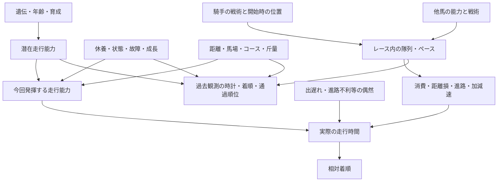

# 統一順位モデル設計と12の暫定結論

**本書は研究候補の設計仕様。実測優位が確認された完成仕様ではない。** 新しい本番予測は未採用。exact順位分布試作は `arvexq/research/rank_distribution.py`。生理状態・能力の推定器、展開発生確率の学習器、校正器は未完成。

## 現行mainの実経路

1. app.py の取得処理がJRA/NAR等のsourceを収集し、`prepare_race_detail`（app.py:4627）を呼ぶ。
2. services/race_analysis.py がmerge／normalizeし、ability.pyを経由してfactor_model.pyの `rank_factor_model` へ進む。
3. domain/legacy_evaluation.pyの最終評価経路（1231付近）が `apply_core_marks` を呼び、同じfactor_modelを使用。名前がlegacyでも現在呼ばれるコードであり、死コードとはしない。
4. TRUE RUNは5,4,3,2,1で重み付けした頭数補正着順、PUREは同じ頭数補正着順の最高と中央値の平均、SECTIONALは上がり順位／percentile。45/35/20、欠損=.5。潜在走行能力を別に推定しているわけではない。
5. Python final_marks.pyはscore・coverage・gapからA/B/Cと◎○▲△等を決定。これは実測確率閾値ではない。
6. UI app.jsの `assignPredictionMarks` は別実装でraw過去走を集め、同配点からtemperature=.15のPLによりP1/P2/P3を計算。Pythonと履歴候補key／日付normalization／同score tie-breakの違いがある。現行のpredictは `assignPredictionMarks` 後に `applyFrozenMarks` を適用し、発走前は最新計算、発走後は保存原本を表示する。旧 `applyServerAuthoritativeMarks` は現行に存在しない。Python/UIの別実装があるため、完全な単一計算authorityとは未認定。
7. UIの軸候補はPL podium値と過去top3率の60/40別score。これは本指令の「同一分布だけで印」に未適合。現行の表示仕様だけを見て統一済みと扱わない。
8. `buildAiBetPlan` は同じscoreからPL順序を再計算し、馬連1点、ワイド1点、条件を満たす3連単最大6点等を選ぶ。券種ごとの実測校正／EVは未確認。
9. 取得・事前計算→SQLite→sync→Cloudflare D1、seal_detail／restore_sealが原本を保護。UIは発走後保存予想へ戻る。既存の取消表示と原本を維持する。
10. mass_model_training.pyは研究用CatBoost head群。final_marksから呼ばれていない。本番学習済みモデルとはしない。`split_walk_forward` の同日跨ぎは今回修正したが、関数は単一holdoutであり反復walk-forwardではない。

旧方式の削除は置換が独立検証に合格した時のみ。今回候補が不合格なので予測経路の削除／追加scoreの本番導入は行わない。

## 根本因果構造と測定可能性

この図は文献と競走構造を基にした仮説で、今回235件の確率だけから因果係数を推定した図ではない。過去着順は、能力・相手・展開・条件の共通結果であり、着順を複数名称で再利用しても独立情報は増えない。

| 要素 | 観測／推定の区別 | 検証可能な仮説と必要データ |
|---|---|---|
| 潜在能力・能力発揮率 | 直接観測不可 | 補正時計と対戦networkの時系列state。観測誤差と状態変動を分離できるか検証 |
| 実績走行 | 時計・着差・条件は観測可能 | 馬場variantを過去時点だけで推定すると同条件未知raceでlossが下がるか |
| 最高速・加速・減速耐性 | 個体区間/GPSが必要 | 個体速度曲線なしで全体ラップを各馬速度と呼ばない。保持率を独立測定可能か |
| 持続力・スタミナ・corner性能 | latent、位置/速度から推定 | 後半減速に早期消費・距離損が追加説明力を持つか |
| 適性・再現性 | 観測履歴から部分的に推定 | 同surface/distance等とのinteractionを時系列holdoutで追加比較 |
| 精神状態・体調・故障 | 通常データだけでは識別困難 | 調教／診療／定時映像情報を許諾取得。観測できなければ欠損として扱う |
| 騎手・厩舎・血統 | IDや血統は観測可能、効果は交絡あり | 馬の選択・クラス・相手を考慮した縮約効果が未知期間で独立寄与するか |
| レース難易度 | 確率分布と入力不足から推定 | entropy等が失敗率と対応するか別期間で校正。高entropyを80%保証へ転換しない |

速い馬が必ず勝つわけではないのは、結果が対戦条件と実現した競走過程に依存するためという説明仮説。今回データでは人気薄激走や疲労の因果を断定できない。失敗レース一覧はmeasurements.jsonに保存し、原因分類は「封印確率だけでは識別不能」とした。

## 採用・除外・保留

「研究候補」と「本番採用」を分離する。今回新たに本番へ採用した予測特徴量は0。

| 判定 | 項目 | 理由／追加検証 |
|---|---|---|
| 採用（検証基盤） | race単位／日付単位分離、発走前時計、hash、取消ID、明示欠損、対数損失 | 漏洩・算術の要件。学習split修正をテスト済み |
| 研究候補 | 近走着順、補正時計、着差、class、条件類似度、休養、相手network | 観測できる範囲で候補。現行scoreとの公平比較・ablation未実施 |
| 保留 | 上がり順位・個体テン1F・区間速度 | 保存3,044頭の必要順位値は全欠損。個体GPSもなし。時計から架空の順位を作らない |
| 保留 | 血統、騎手、厩舎、体重、調教、状態 | 独立効果未測定。時系列ID統計・縮約・missingness-aware学習が必要 |
| 保留 | 展開interaction、状態空間、variance、scenario likelihood | 対応する教師／発走前観測不足 |
| 除外（新モデル候補） | 結果、払い戻し、最終オッズ、未来の成績、事後訂正指数 | 当該予測時計で存在を証明できない |
| 除外（今回採用判断） | 保存P1の0.75power補正 | 後期lossが悪化。旧scoreへ上乗せしない |
| 未決定 | 現行固定45/35/20の撤去対象、どの観測特徴を削除するか | 情報重複は構造的に存在するが性能ablation未実施。新方式不採用のまま本番撤去しない |

## 近走5走の候補仕様

発走前に存在した入力だけを集合にする。raceId、日付、会場、レース番号で重複統合し、同日・未来走を除外し、日時の降順で直近5走を抽出。現行Pythonのobserved_runsを基準にschemaを統一する。新馬は0走として明示し、足りない履歴を過去走や指数で埋めない。

各走は着順／頭数、秒単位の時計・着差、surface・距離・class、斤量、going、通過順位、取得時計を別々に保持。単位不明の着差は秒扱いしない。馬場variantとclass補正はTRAIN内だけで学習し、VALID/TESTの当日全raceで事後推定しない。

新しさ・条件類似度・観測信頼性を特徴として学習し、5:4:3:2:1固定重み、最高中央値、条件近似、状態空間の各候補を比較する。「結果以上に強い」は有利／不利の別観測があり、その追加効果が再現した時のみ判断する。コーナー順位から実距離損、脚質から出遅れ確率を捏造しない。代表走は過去時点までで選び、未来好走で遡及して選ばない。最適仕様は未確定。

## 順位・展開の統一候補

能力／条件推定器が学習した `eta_i(x, s)` を出す。シナリオsの発生確率 `pi_s(x)` も発走前観測から学習し、和1を検査する。PL基準モデルの正のstrengthを `w_is=exp(eta_i(x,s))` として:

`P(order | s,x)= product_k w_(order[k],s) / sum_{j not yet selected} w_js`

`P(order | x)= sum_s pi_s(x) P(order | s,x)`。

シナリオ混合は順位分布で行い、平均scoreをPLへ入れる方法と同一視しない。出遅れ・単騎逃げ・先行争い・早仕掛け・馬場bias等は未学習。コースの勾配／曲率／直線／最初のcorner距離は観測仕様と出典を保持し、未知形状は欠損。不確実性は入力欠損とモデルparameter uncertaintyとレース内偶然を分離する。

PLのIIA仮定で説明できない相互作用は、検証済みシナリオ効果または時間状態／相関走行モデルと比較する。複雑化で自動改善するとはしない。

試作は1〜18頭の全着順周辺確率をsubset DP（O(n 2^n)）で厳密計算し、上位3頭のordered jointを列挙。取消馬は呼び出し時strength集合から除外し、その集合で分布を作る。数学的検査は各順位の和1、各馬の全順位和1、podium joint和1、1〜3着合計≤1。実測校正済みの旗は常にfalse。これを本番エンジンに接続していない。

18頭の全順位試作は、この環境の合成strength一回測定で約1.57秒。Cloudflare実測ではない。キャッシュや事前計算の可能性はあるが、全開催・UI速度改善を達成したとはしない。

## 印と買い目

- ◎【単】は同じ分布のP1最大、◎【軸】はP1+P2+P3最大を別々に選ぶ。同馬なら両表示。別の安定性scoreを加えない。
- ○はP1+P2、▲はP2+P3、△はP3で候補を比較。印の重複／点数制約を決定問題として明示する。☆は検証済みscenarioで基準より好走確率が増える馬、注は観測根拠がある限定候補のみ。
- A/B/Cは未閲覧期間での実測確率と信頼区間から決める。今回108件だけで全条件閾値は決めない。未校正出力を実際の的中率として表示しない。
- 単勝／馬単／馬連／ワイド／3連複／3連単は同じjointのイベント和。ワイド複数点の「少なくとも1点的中」はイベントのunionで計算し、重なったoutcomeを一回だけ数える。単独勝率積を使わない。
- 期待回収率は予測時計の券種オッズと校正済み確率がある時だけ `sum p_combo * payout_ratio_combo / total_stake`。単勝オッズから組合せ券種オッズを作らない。取得時計不明ならEV=null。
- 点数上限／予算／riskを外生制約として固定。目標80%に達しなければ該当なし。3連単challengeは順序校正が検証されるまで本番選定方式を新設しない。

## 12項目の結論台帳

| 問い | 暫定／確定の結論 | 根拠・反証・信頼性・条件・未解決 |
|---|---|---|
| 1 勝敗の根本 | 能力の実現と対戦過程の相対結果を分離 | 文献とrace構造の仮説、因果係数未測定。生理全要素が観測できるわけではない |
| 2 独立寄与情報 | 現時点で新特徴の独立寄与は未確定 | 235件は保存確率中心。raw追加featureのablation不能 |
| 3 5走の最適評価 | 固定新しさ重みを最善とは認定しない | 条件類似・状態・時計候補は未比較。最高中央値は同じ着順の再表現 |
| 4 能力と勝率 | 単一scoreを実測勝率と呼ばない | 公開ratingとコード構造。今回の相手と条件付き分布が必要 |
| 5 展開統合 | scenario条件付きjointの混合を基準候補 | 確率法則はテスト済み。scenario発生率の実測は未測定 |
| 6 血統等 | 階層縮約／時系列統計の候補、固定加点は保留 | 選択交絡と小標本。追加効果の数値なし |
| 7 最良AI | 実測最良の新AIは選定できない | 補正候補は後期loss悪化。CatBoost等は未訓練比較 |
| 8 削除特徴 | 後知恵データは禁止、性能寄与の不要特徴は未確定 | 100%欠損sectionalは取得問題として扱う。新方式検証前に現行撤去しない |
| 9 着順確率 | 同じjointから周辺と券種イベントを導出 | 古い235件中49件で上位3確率和>1。PL試作は数学的整合、校正は未証明 |
| 10 印・買い目 | 同じjointと測定済み校正に基づく | 現行の軸別score・A/B/C固定閾値は指令への未適合。新閾値未決定 |
| 11 中央地方 | schema・時計・分布・評価を共通化、条件効果を縮約して分離する候補 | 全会場・新馬・障害の十分な評価なし。全部別モデルが優位とも未確定 |
| 12 改善順 | 保存・入力時計・区間欠損・現行version同定を先に修復 | 実測235件と原本監査。新モデル置換／回収率改善／80%達成の証拠なし |

再評価は、少なくとも複数開催期の発走前原本、全競馬場・距離・class別coverage、予測時刻オッズ、原本買い目、完全結果を確保して実施する。対象件数は恣意的に決めず、検出したい効果に必要な不確実性から設計。今回の後期データを再利用して候補を調整し最終成績としない。
